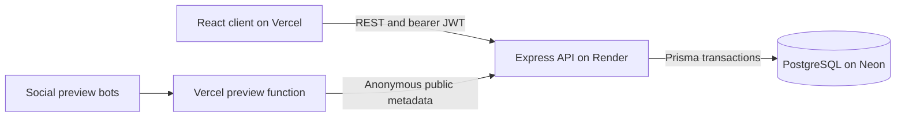
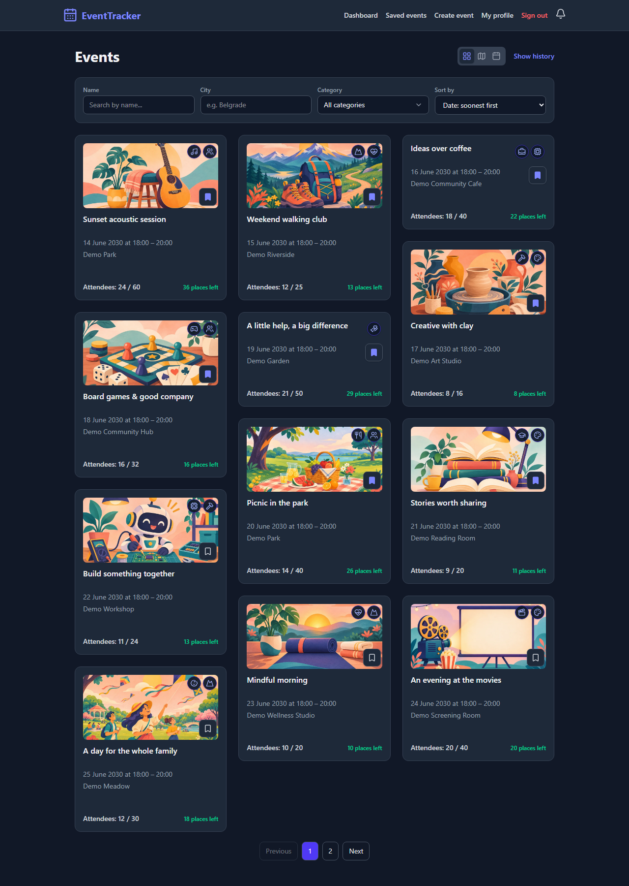
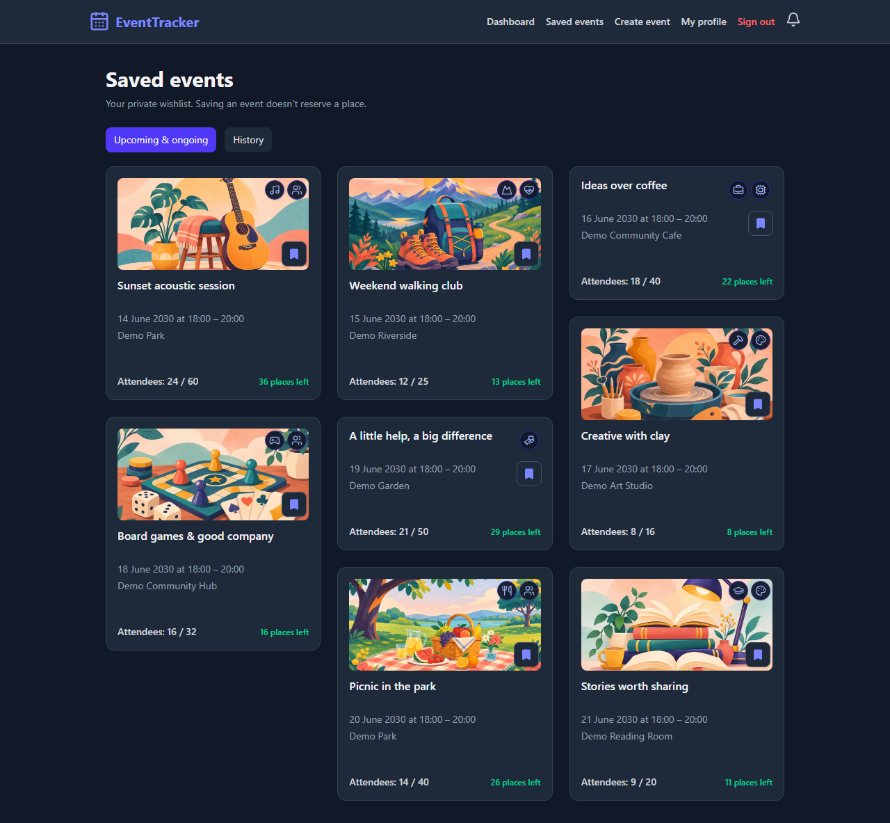
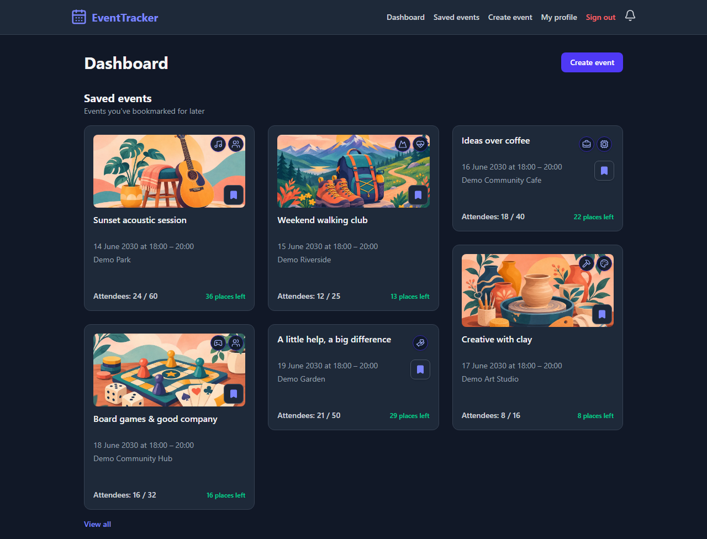
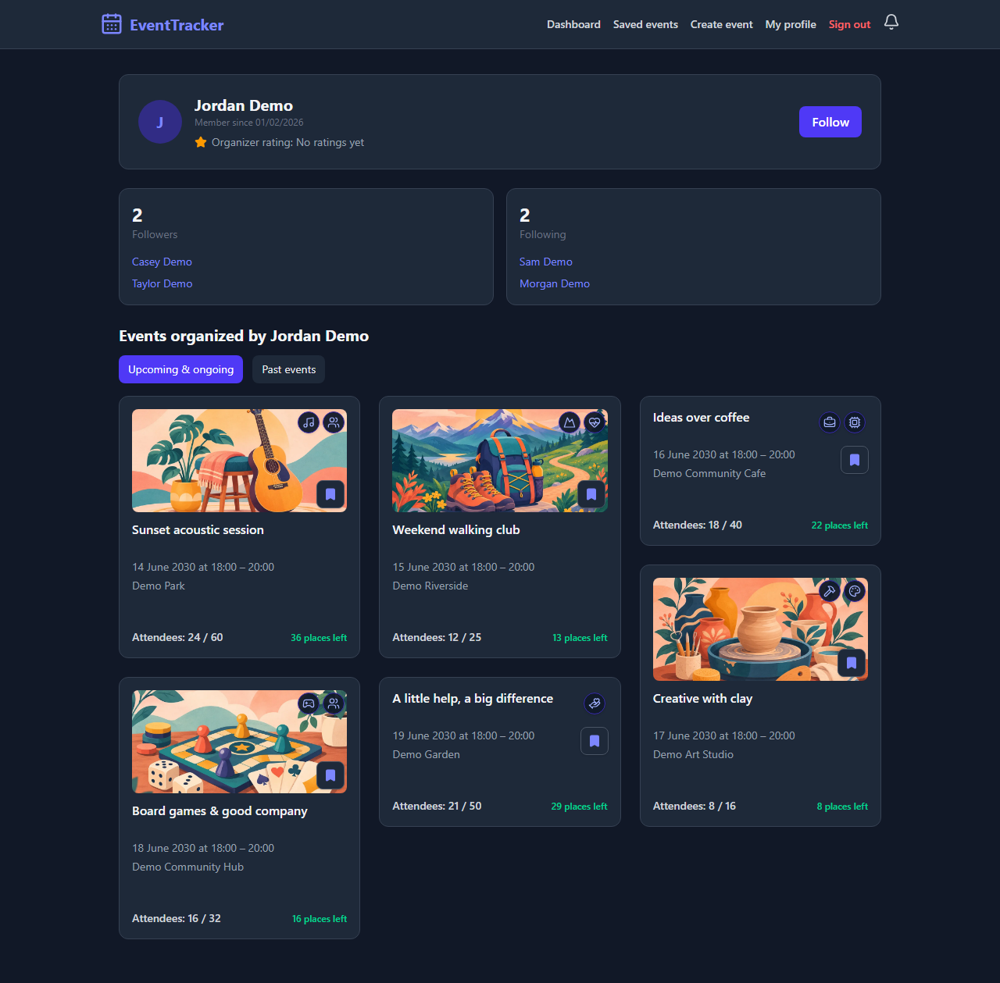
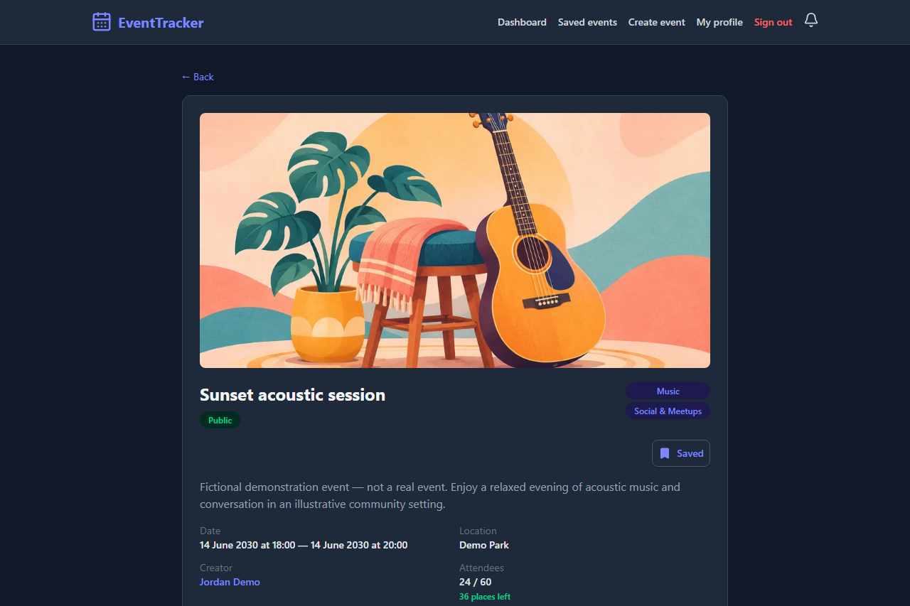
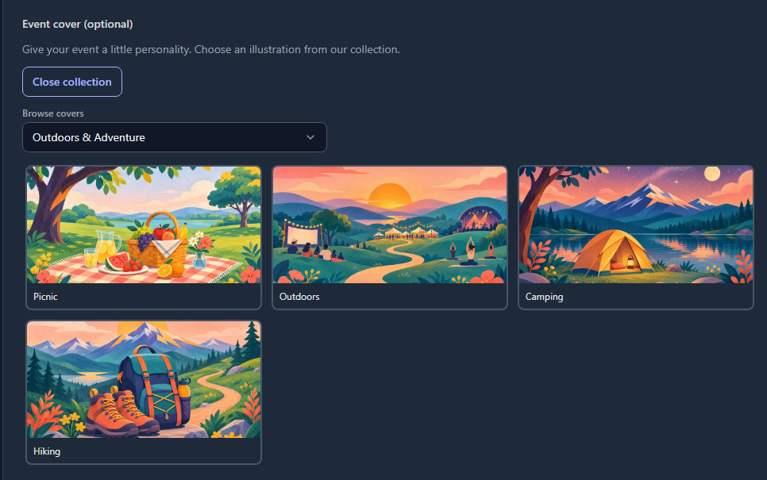
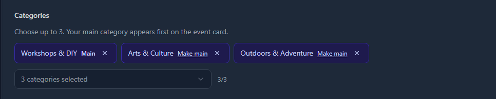
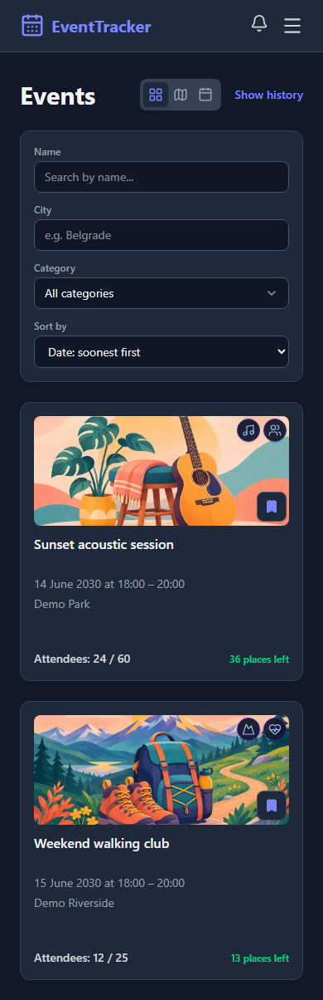

# Event Tracker

A full-stack event platform for discovering local activities, organizing gatherings and keeping a private wishlist. It handles the details that become difficult once people actually use an app: competing registrations for the last seat, changing event visibility, recurring cancellations and delayed background notifications.

**[Live demo](https://event-tracker-liard-seven.vercel.app)** | **[API reference](docs/API.md)** | **[Development and deployment](docs/DEVELOPMENT.md)**

React 19 | TypeScript | Express 5 | PostgreSQL | Prisma | Vite | Tailwind CSS

## Architecture



The client uses React Router and loads secondary pages, maps and calendars on demand. The API owns validation, visibility and authorization. PostgreSQL stores accounts, event relationships and notification delivery state. Google OAuth and Leaflet/OpenStreetMap support sign-in and map selection.

Background notification checks run inside the API process at startup and every 15 minutes. There is no paid queue, external cron or image-storage service.

## Three engineering decisions

### 1. Serialize registration where capacity is enforced

Two requests can both observe the final free seat if capacity checking and insertion happen independently. Registration locks the event row and checks capacity inside the transaction before inserting. The organizer's seat is created atomically with the event. Only competing operations for that event wait on its lock.

[Registration implementation](server/src/controllers/registrationController.ts) | [PostgreSQL race tests](server/tests/eventReliability.integration.test.ts)

### 2. Keep authorization on the server and recheck current state

Staff access uses the current database role, so a previously issued token does not preserve revoked moderator privileges. Visibility is checked in backend queries and participation endpoints. A bookmark never grants access to a private event, and normal event pages expose management controls only to their organizer; staff management uses protected admin routes.

[Authentication middleware](server/src/middleware/authMiddleware.ts) | [Saved-event visibility](server/src/utils/savedEvents.ts) | [Permission tests](server/tests/moderators.test.ts)

### 3. Persist notification delivery decisions

Unread join notifications group per event. Rating prompts have durable rollout and sent flags, and workers recheck eligibility while holding an event lock. This prevents overlapping workers from sending the same prompt again. The simpler in-process scheduler fits free hosting, with the explicit trade-off that sleep and backlogs can delay delivery.

[Rating worker](server/src/utils/eventRatingPrompts.ts) | [Notification integration tests](server/tests/eventParticipationNotifications.integration.test.ts)

## What it does

- **Discover:** search, city/category filters, map/calendar views, illustrated covers and server-side pagination.
- **Organize:** date ranges, capacity, recurring occurrences, invitations and permanent cancellation with retained history.
- **Participate:** join/leave before the start, view attendees and rate registered events after they end.
- **Save:** private account-based bookmarks, upcoming/history views and a six-event dashboard preview.
- **Personalize:** private category interests on your profile, with recommendations scored from interests, saves and past registrations; no AI service required.
- **Dashboard:** separate Recommendations, Explore, Saved, Attending, Your events and Following tabs. Recommendations and Explore show up to three events each; other previews show up to six with View all when needed.
- **Connect:** follows, organizer profiles, comments/replies and in-app notifications.
- **Moderate:** reports, timed bans, staff event tools and admin-only moderator assignments.
- **Control access:** public, followers-only and invite-only events with server-enforced permissions.
- **Share:** public Open Graph previews with generic fallbacks for private or unavailable events.
- **Search metadata:** route titles/descriptions, canonical URLs, indexing rules and a public-event sitemap that excludes fictional demo events.

## Try the demo

1. Browse the public **[DEMO]** events, filter by category and switch between list, map and calendar views.
2. Open an event to see its categories, availability, organizer and discussion.
3. With your own account, bookmark events and open **Saved events** or the dashboard preview. Saving does not reserve a place.
4. Choose interests on **My profile**, then try **Recommendations** and **Explore** on the dashboard. Past registrations indicate interest, not verified physical attendance.
5. Create an event to try visibility settings, the cover collection and organizer controls. Your organized events appear on the dashboard; other organizers' events appear on their public profiles.

Hosted demo events are explicitly fictional. Their descriptions say **NOT A REAL EVENT**, venues are illustrative and dates do not refresh automatically. No shared admin credentials are published.

## Screenshots

These screenshots use fictional demonstration events, locations and accounts. They do not contain real user records or private addresses. They were captured before the latest dashboard tabs, interest selector and compact card metadata changes.

**Discover events:** illustrated covers, category icons, bookmarks, availability labels, search filters and numbered pages.



<details>
<summary>More screenshots: saved events, dashboard, profiles, event details, cover selection, categories and mobile</summary>

**Saved events:** a private wishlist with upcoming/ongoing events and a separate history view.



**Earlier dashboard preview:** up to six saved events, with View all when more are available. The current dashboard separates its sections into tabs.



**Organizer profile:** followers and following above the organizer's upcoming and past events.



**Event summary:** a cover, description, visibility, selected categories, bookmark control and attendance/availability information.



**Cover library:** browse the bundled illustrations by category without uploading files.



**Category selection:** choose up to three categories and set the main one.



**Mobile discovery:** the same event cards and filters adapt to a narrow screen.



</details>

## Run locally

Use Node.js 24 and a local PostgreSQL database. Copy the example environment files and replace their placeholder values. Google client IDs are needed for Google sign-in.

```bash
git clone https://github.com/M1hailo1/Event-Tracker.git
cd Event-Tracker/server
npm ci
cp .env.example .env
npx prisma generate
npx prisma migrate deploy
npm run dev
```

In another terminal:

```bash
cd Event-Tracker/client
npm ci
cp .env.example .env
npm run dev
```

Open `http://localhost:5173`. The API defaults to `http://localhost:3000`. See the [development guide](docs/DEVELOPMENT.md) for database setup, test permissions, Windows commands and deployment configuration.

## Verification

| Location | Command | Purpose |
| --- | --- | --- |
| `server/` | `npm test` | Full Jest suite against a freshly migrated, disposable local database |
| `server/` | `npm run test:reliability` | Focused PostgreSQL lifecycle, permissions, pagination, saves and notification races |
| `server/` | `npm run test:safety` | Verify hosted/application database targets are refused |
| `server/` | `npm run build` | Type-check and compile the API |
| `client/` | `npm audit --audit-level=moderate` | Check dependencies for reported moderate-or-higher advisories |
| `client/` | `npm run lint -- --max-warnings=0` | Lint without warnings |
| `client/` | `npm run build` | Type-check and build the client |
| `client/` | `npm run test:share` | Public-only metadata, escaping, preview fallbacks and sitemap responses |
| `client/` | `npm run typecheck:tests` | Type-check browser tests and their configuration |
| `client/` | `npm run test:browser` | Desktop/mobile authentication, accessibility, sessions, discovery, interests, dashboard tabs and SEO metadata |

Before the first browser test run, use `npx playwright install chromium`. Browser tests run a local client with fictional API fixtures and block external requests; real Google OAuth and deployed hosting behavior require separate live verification.

The [CI workflow](.github/workflows/ci.yml) runs builds, lint, safety, backend, sharing and browser checks on pushes and pull requests. It uses an isolated PostgreSQL service and does not deploy the application or connect to Neon.

## Performance and free-hosting limits

A three-round [HTTP measurement](assets/performance/demo-2026-11-04.json) recorded a 22.6-second first event-page response, followed by 99 ms and 139 ms responses. This is consistent with a cold service becoming warm; it does not isolate Render startup from database wake-up or measure complete browser rendering.

Local [production-build measurements](assets/performance/client-bundle-2026-11-04.json) show upfront JavaScript reduced from **596.7 KB to 346.9 KB** by deferring secondary routes, maps and calendars. That is approximately **42% less uncompressed JavaScript**, or **37% less with the recorded gzip settings**. Shared initial chunks are included in those totals.

Discovery gives slow-load feedback, retains the last results during a failed refresh, supports retry and aborts superseded requests. Quick background updates stay visually quiet; a visible refresh notice appears after four seconds. Discovery requests time out after 65 seconds. These changes improve the waiting experience; they do not remove free-host wake-up delays. Measurements can be repeated manually from `client/` with `npm run measure:demo`; no keep-alive polling is scheduled.

## Search indexing and deployment

The basic SEO pass adds route metadata, canonical URLs, `robots.txt` and `/sitemap.xml`. The sitemap uses the API's anonymous `/seo/events` endpoint and includes only future, noncancelled public events from unbanned organizers, excluding explicitly labelled fictional demo events. Account/staff pages request no indexing. Event metadata comes only from the anonymous public-sharing endpoint, even for signed-in visitors; private event metadata stays generic.

Ordinary event pages still render through JavaScript; this is not server-side rendering or a guarantee of search indexing. No event structured data or Search Console setup is included. A sleeping API can cause the sitemap to return a retryable 503 response. Deploy both the API and Vercel client before verifying the live sitemap, indexing headers and latest dashboard changes. No additional database migration is needed for the SEO work.

## Current boundaries

- New passwords require at least 8 characters; registration and login reject more than 72 UTF-8 bytes. Existing shorter-password accounts can still sign in.
- Bearer JWTs expire after seven days and are stored in browser local storage. The UI clears expired/invalid sessions while preserving sessions during temporary connection failures. There is no refresh-token or server-side logout/revocation system.
- Email verification and password recovery are deferred; no email delivery service is configured.
- Reminders and rating prompts may arrive late when the free backend sleeps.
- Covers come from the bundled illustration library; user uploads and physical-attendance check-in are not implemented.

Originally developed as a diploma thesis and continued as an independently maintained full-stack project.

**Mihailo Maricic** | [GitHub](https://github.com/M1hailo1)
